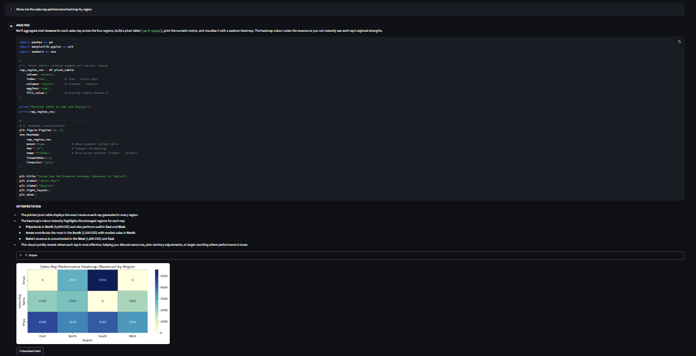

# 🤖 AI Data Analyst

**Upload your data. Ask questions in plain English. Get charts, analysis, and insights instantly.**

AI Data Analyst is an interactive data-analysis tool that lets you upload datasets in multiple formats and explore them using natural-language questions. Instead of returning canned chart types, the AI generates and executes the **actual pandas/matplotlib/seaborn code** needed to answer your question, then explains the result.

[](https://askthedata-ai.streamlit.app/)
[](https://askthedata-ai.streamlit.app/)
[](LICENSE)
[](https://github.com/ayush-s-tomar/ai-data-analyst/actions/workflows/ci.yml)

> **TL;DR**
> - 💬 **Ask questions in plain English** — the AI writes and runs the pandas/seaborn code required to answer them.
> - 📊 **Generate charts automatically** — get bar charts, line charts, scatter plots, heatmaps, and more from natural-language prompts.
> - 📁 **10 file formats supported** — upload CSV, Excel, PDF, Parquet, XML, SQLite, ODS, Feather, TSV, or JSON directly.
> - 🧠 **Follow-up questions** — session memory lets you build on previous analysis.
> - ⚡ **Fast inference** — powered by Groq's LPU infrastructure.
> - 🆓 **Free to run** — Groq's free tier provides inference and Streamlit Community Cloud provides hosting.

---

## 📚 Contents

- [Demo](#-demo)
- [Features](#-features)
- [Supported File Formats](#-supported-file-formats)
- [Live Demo](#-live-demo)
- [Tech Stack](#️-tech-stack)
- [Why Streamlit over FastAPI + React?](#-why-streamlit-over-fastapi--react)
- [Local Setup](#-local-setup)
- [Deployment](#️-deployment-streamlit-community-cloud)
- [Project Structure](#-project-structure)
- [Example Prompts](#-example-prompts)
- [Limitations](#️-limitations)
- [Roadmap](#-roadmap)
- [License](#-license)

---

## 📸 Demo



Ask a question such as:

> **"Show me the sales rep performance heatmap by region."**

The AI determines the required analysis, generates the corresponding pandas/seaborn code, executes it, and presents the resulting visualization and explanation — all without writing code yourself.


🎬 **Full walkthrough**

[Watch the full demo](https://github.com/user-attachments/assets/8920ab9e-936d-456d-b58d-496543618e43)

---

## ✨ Features

| Feature | Description |
|---|---|
| 📁 **Multi-format upload** | Upload CSV, Excel, PDF, Parquet, XML, SQLite, ODS, Feather, TSV, or JSON files directly |
| 💬 **Natural-language queries** | Ask questions about your data the same way you'd ask a colleague |
| 📊 **Automatic visualizations** | Generate bar charts, line charts, scatter plots, heatmaps, and other visualizations |
| 🧠 **Session memory** | Ask follow-up questions that build on previous analysis |
| 🐍 **AI-generated code** | The AI writes and executes the pandas/matplotlib/seaborn code needed for the requested analysis |
| ⚡ **Fast inference** | Powered by Groq's LPU infrastructure |
| 🆓 **Free to run** | Uses Groq's free tier and Streamlit Community Cloud |

---

## 📂 Supported File Formats

| Format | Extensions |
|---|---|
| CSV | `.csv` |
| Excel | `.xlsx`, `.xls` |
| PDF | `.pdf` |
| Parquet | `.parquet` |
| XML | `.xml` |
| SQLite | `.db`, `.sqlite` |
| OpenDocument Spreadsheet | `.ods` |
| Feather | `.feather` |
| TSV | `.tsv` |
| JSON | `.json` |

No manual conversion is required — upload the file and start asking questions.

---

## 🌐 Live Demo

### [Try AI Data Analyst →](https://askthedata-ai.streamlit.app/)

The current version runs as a single Streamlit application, keeping the deployment simple and avoiding the separate frontend/backend architecture used by the earlier version.

---

## 🛠️ Tech Stack

| Layer | Technology |
|---|---|
| **Application** | Streamlit |
| **AI Model** | Groq API — `openai/gpt-oss-120b` |
| **Data Processing** | pandas |
| **Visualization** | matplotlib, seaborn |
| **Hosting** | Streamlit Community Cloud |
| **CI** | GitHub Actions |

---

## 🔄 Why Streamlit over FastAPI + React?

The project originally used a **FastAPI backend + React frontend**, deployed separately on Render and Vercel.

That architecture introduced additional operational overhead:

- Two separate services to deploy and maintain
- Render free-tier sleep/cold-start behavior
- Keep-alive workarounds
- CORS configuration
- Coordination between two deployment platforms

For a lightweight, single-user data-analysis application, that complexity wasn't necessary.

The application was therefore migrated to **Streamlit**, which brings the UI, file processing, AI integration, and visualization workflow into a single application.

### The result

**One application → one deployment target → simpler maintenance.**

The original FastAPI and React implementation remains available under [`legacy/`](legacy/) for reference.

---

## 🚀 Local Setup

### Prerequisites

You'll need a free **Groq API key**.

1. Create an account at [console.groq.com](https://console.groq.com/)
2. Open **API Keys**
3. Create a new API key

### 1. Clone the repository

```powershell
git clone https://github.com/ayush-s-tomar/ai-data-analyst.git
cd ai-data-analyst/streamlit_app
