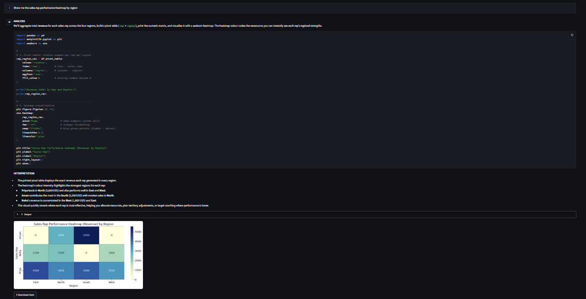

# 🤖 AI Data Analyst

Upload your data — CSV, Excel, PDF, Parquet, XML, SQLite, ODS, or Feather. Ask questions in plain English. Get instant charts & insights.

[](https://askthedata-ai.streamlit.app/)
[](https://askthedata-ai.streamlit.app/)
[](LICENSE)
[](https://github.com/ayush-s-tomar/ai-data-analyst/actions/workflows/ci.yml)

## TL;DR

- 💬 **Ask in plain English.** The AI writes the pandas/seaborn code, the app runs it, and the explanation is written from the **actual output**, not guessed in advance.
- 🛡️ **Generated code is contained.** Every script is checked against an import/attribute allow-list and runs in a separate, time-limited process that does not inherit your API key (see [Security model](#-security-model)).
- 📁 **10 file formats, zero conversion step** — CSV, Excel, PDF, Parquet, XML, SQLite, ODS, Feather, TSV, JSON.
- 🆓 **Free to run** — Groq's free tier for inference, Streamlit Community Cloud for hosting.
- 🔁 **Migrated for a real reason** — moved off FastAPI + React (Render + Vercel) after Render's free tier kept running out; now one Streamlit app and one deploy target (see [Why Streamlit](#-why-streamlit-over-fastapi--react)).

## 📚 Contents

[Demo](#-demo) · [Features](#-features) · [Supported Formats](#-supported-file-formats) · [How it works](#-how-it-works) · [Security model](#-security-model) · [Live Demo](#-live-demo) · [Tech Stack](#-tech-stack) · [Why Streamlit](#-why-streamlit-over-fastapi--react) · [Local Setup](#-local-setup) · [Tests](#-tests) · [Deployment](#-deployment-streamlit-community-cloud) · [Project Structure](#-project-structure) · [Limitations](#-limitations) · [Roadmap](#-roadmap) · [License](#-license)

## 📸 Demo



Asking *"Show me the sales rep performance heatmap by region"* generates a heatmap in seconds — no code required. The AI writes the pandas/seaborn code, the app runs it, and the explanation describes what the results mean.


🎬 **Full walkthrough:**

https://github.com/user-attachments/assets/8920ab9e-936d-456d-b58d-496543618e43

## ✨ Features

| Feature | Description |
|---|---|
| 📁 Multi-format upload | Drag and drop CSV, Excel, PDF, Parquet, XML, SQLite, ODS, Feather, TSV or JSON — no setup, no conversion |
| 💬 Natural language queries | Ask questions the way you'd ask a colleague |
| 📊 Auto-generated charts | Bar, line, scatter, heatmap, and more, from AI-written pandas/seaborn code, with PNG download |
| ✅ Grounded explanations | The explanation is generated after the code runs, from the real printed output |
| 🔁 Self-repair | If generated code fails, the model gets the error once and returns corrected code |
| 🙅 Honest refusals | Asking about a column that doesn't exist returns a clear "can't answer", not an invented number |
| 🧠 Session memory | Follow-up questions build on previous answers |
| 💡 Smart starters | Suggested questions are built from your file's own columns |
| ⚡ Fast inference | Powered by Groq |
| 🆓 100% free to run | No paid API keys required |

## 📂 Supported File Formats

| Format | Extension |
|---|---|
| CSV | `.csv` |
| Excel | `.xlsx`, `.xls` |
| PDF | `.pdf` |
| Parquet | `.parquet` |
| XML | `.xml` |
| SQLite | `.db`, `.sqlite`, `.sqlite3` |
| OpenDocument Spreadsheet | `.ods` |
| Feather | `.feather` |
| TSV | `.tsv` |
| JSON | `.json` |

Files are limited to 25 MB. Pickle files are intentionally **not** supported, because unpickling an untrusted file can execute arbitrary code.

## 🧭 How it works

1. **Upload** — the file is parsed into a pandas DataFrame (`file_readers.py`).
2. **Ask** — your question, a compact description of the data and recent chat history go to the model (`analyst.py`).
3. **Code** — the model returns pandas/seaborn code, or `CANNOT_ANSWER` if the data can't answer the question.
4. **Run** — the code is validated and executed in an isolated subprocess (`sandbox.py`).
5. **Repair** — on an error, the model gets one chance to fix its code.
6. **Explain** — a second model call explains the real output and charts.

## 🛡️ Security model

AI-generated code is the main risk of this kind of app, so it is contained in layers:

- **Static validation.** Only pandas, numpy, matplotlib, seaborn and a few standard-library modules can be imported. Dunder/private attribute access, `open`, `eval`, `exec`, `getattr`, file/network helpers (`read_*`, `to_csv`, `savefig`, `load`, …) and class definitions are rejected before anything runs.
- **Restricted builtins.** The code runs with a small allow-list of builtins and a guarded `import`.
- **Process isolation.** Code runs in a separate Python process with a scrubbed environment (the Groq key is not inherited), a 25-second wall-clock timeout, and CPU / file-size limits on Linux.
- **Tested.** The test suite includes attack-style cases (`import os`, `__class__` tricks, `pd.read_csv('/etc/passwd')`, infinite loops, environment leakage).

> **This is defence in depth, not a hardened container sandbox.** A determined attacker may still find a bypass, the worker runs as the same OS user as the app, and the public demo uses a shared API key. Don't upload sensitive data to the public demo. For multi-user production use, run the worker in a container or microVM.

**Privacy:** column names, data types, summary statistics and the first rows of your file are sent to Groq's API so the model can write code. Nothing is stored between sessions.

## 🌐 Live Demo

**[askthedata-ai.streamlit.app](https://askthedata-ai.streamlit.app/)** — single-service Streamlit app, no separate backend to wake up. Streamlit Community Cloud puts apps without traffic to sleep (after about 12 hours), so the first visit after a quiet period may show a "wake this app up" button and take a few seconds to start.

## 🛠️ Tech Stack

| Layer | Technology |
|---|---|
| App | Streamlit |
| AI Model | Groq API — `openai/gpt-oss-120b` |
| Data Processing | pandas, numpy, matplotlib, seaborn |
| Code isolation | Python `ast` validation + subprocess |
| Testing / CI | pytest, flake8, GitHub Actions |
| Hosting | Streamlit Community Cloud |

## 🔄 Why Streamlit over FastAPI + React?

This project originally shipped as a FastAPI backend + React frontend, deployed on Render + Vercel. That setup meant two services to keep alive, a keep-alive ping workaround for Render's free-tier cold starts, and CORS/deployment coordination across two platforms for a single-user data tool that didn't need it. Render's free tier also spins services down after 15 minutes of inactivity and shares one 750-hour monthly allowance across a workspace, which the setup kept exhausting.

Streamlit collapses that into one file and one deployment target, so there is at most one cold start (Streamlit Cloud's own). A better fit for the actual use case. The legacy code is kept for reference but is no longer the deployed path. Moving back to a container host only makes sense if the app needs always-on hosting, per-user accounts or stronger isolation than a subprocess — see the [Roadmap](#-roadmap).

## 🚀 Local Setup

### Prerequisites

Get a free Groq API key — no credit card needed:

1. Sign up at [console.groq.com](https://console.groq.com)
2. Go to **API Keys** → **Create API Key**

### Run it

```powershell
git clone https://github.com/ayush-s-tomar/ai-data-analyst.git
cd ai-data-analyst/streamlit_app
python -m venv venv
venv\Scripts\activate
pip install -r requirements.txt
```

Create `.streamlit/secrets.toml` inside `streamlit_app/` (this file is gitignored):

```toml
GROQ_API_KEY = "gsk_your_key_here"
```

Start the app:

```powershell
streamlit run streamlit_app.py
```

✅ App running at `http://localhost:8501`

## 🧪 Tests

```powershell
pip install -r requirements-dev.txt
python -m pytest -q
```

The suite covers the code sandbox (blocked imports, attribute tricks, timeouts, key isolation), all file readers, and the model orchestration with a fake client (explanations grounded in real output, refusals, repair, history cap). CI runs lint and tests on every push.

## ☁️ Deployment (Streamlit Community Cloud)

1. Push your project to GitHub
2. Streamlit Cloud → New app → connect your repo
3. Set entry point to `streamlit_app/streamlit_app.py`
4. Add secret: `GROQ_API_KEY = your key`
5. Deploy

## 📂 Project Structure

```
ai-data-analyst/
├── streamlit_app/
│   ├── streamlit_app.py      # UI: upload, chat, charts
│   ├── analyst.py            # Model orchestration: code, repair, grounded explanation
│   ├── sandbox.py            # Code validation + isolated execution
│   ├── file_readers.py       # Parsing for 10 file formats
│   ├── requirements.txt
│   └── .streamlit/           # config.toml (secrets.toml is gitignored)
├── tests/                    # pytest suite
├── legacy/
│   ├── backend/              # Archived FastAPI backend (not deployed)
│   └── frontend/             # Archived React frontend (not deployed)
└── assets/                   # Demo images and screenshots
```

> `backend/` and `frontend/` are archived under `legacy/` for reference only — see [`legacy/README.md`](legacy/README.md) for why they were retired. They are not maintained and not part of the active deployment.

## 💡 Example Prompts

Try asking things like:

- "Show me a bar chart of sales by region"
- "What's the revenue trend over time?"
- "Which product performs best by units sold?"
- "Compare customer ratings across segments"
- "Show me the sales rep performance heatmap by region"

## ⚠️ Limitations

- **Containment is not a full sandbox.** Generated code is validated and runs in a separate time-limited process, but that process shares the host with the app. The public demo uses a shared Groq API key, so treat it as a personal analysis tool and don't upload sensitive data.
- **No authentication.** Single-user by design; there's no login and no per-user isolation.
- **No persistence.** Uploaded data and session memory live only for the current browser session.
- **Model answers can still be wrong.** Explanations are grounded in the code's real output, but the model chooses the analysis. Check important numbers against your data.
- Best suited for exploratory analysis on datasets that fit comfortably in memory (25 MB upload limit); very large files may be slow on the free Streamlit Cloud tier.

## 🗺️ Roadmap

- [x] Allow-list validation and subprocess isolation with a time limit for AI-generated code
- [x] Downloadable chart exports (PNG)
- [ ] Container- or microVM-level isolation for multi-user deployments
- [ ] Multi-file sessions (join or compare across two uploads)
- [ ] Saved query history across sessions
- [ ] Basic auth for a shareable multi-user deployment
- [ ] Accuracy benchmark on known-answer datasets

## 📄 License

MIT — free to use, modify, and deploy.

## 👤 Author

**Ayush Singh Tomar** — [GitHub](https://github.com/ayush-s-tomar) · [LinkedIn](https://linkedin.com/in/ayushsinghtomar) · [Portfolio](https://ayush-s-tomar.vercel.app)