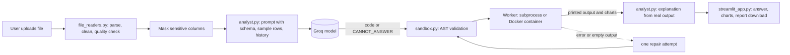

# Architecture and threat model

## Flow

## Threat model

| Threat | Mitigation | Status |
|---|---|---|
| Generated code imports or calls dangerous modules | AST import, name and attribute allow-list; restricted builtins | In place, regression-tested |
| Frame, generator or dunder introspection to reach real builtins | Blocked attribute prefixes and dunder names | In place |
| Code writes files | File-writing helpers blocked; read-only container in Docker mode | Partial in subprocess mode, strong in Docker mode |
| API key theft | Worker environment scrubbed; Docker mode passes no environment | In place, tested |
| Infinite loop or memory bomb | Wall-clock timeout, CPU/file/memory limits (Linux); container limits in Docker mode | Subprocess limits are Linux-only |
| Malicious upload (pickle, XML bombs) | Pickle refused; defusedxml; 25 MB cap | Zip-bomb guard added for xlsx/ods |
| Sensitive values sent to the model | Sensitive-looking columns masked by default; user can choose more | In place; generated code can still use the real values |
| Prompt injection through cell values | Sandbox is the backstop; output explained from real results | Not fully preventable; documented limit |
| Shared API key abuse | Per-session cap; bring-your-own-key | In place; session cap is client-side state only |

## Not covered
Authentication, per-user isolation, persistence, and microVM-level isolation.
